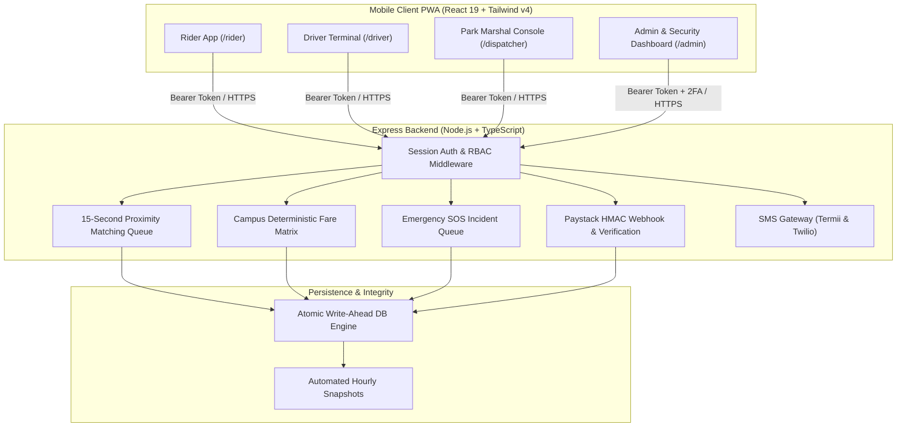

# Zylift — Campus Transit PWA for FUTMINNA

> **Affordable, Safe, and On-Time Campus Ride-Hailing for Federal University of Technology, Minna (Gidan Kwanu & Bosso Campuses).**

---

## Overview

**Zylift** is a purpose-built Progressive Web App (PWA) tailored specifically for Nigerian campus transit ecosystems. It features flat campus fares, 0% platform commission during pilot deployment, 4-digit safety PIN verification, emergency SOS incident dispatch to Campus Security Cadets, real-time driver proximity matching, and dual payment support (Cash and Paystack).

---

## Core System Architecture



---

## Key Features

1. **Deterministic Flat Campus Fares**:
   - Keke: ₦200 flat (Gate $\leftrightarrow$ Hostels, SEET, SAAT, Library).
   - Okada: ₦250 flat.
   - Inter-campus Shuttle: ₦600 fixed.
   - **0% Platform Commission**: 100% of collected cash belongs to registered park drivers.
2. **End-to-End Safety PIN Verification**:
   - Every trip generates a unique 4-digit safety PIN shown only on the student's phone.
   - Drivers cannot start the ride until entering the verified PIN on their terminal.
3. **Emergency SOS & Campus Cadet Integration**:
   - Instant SOS button triggers priority campus security alert with real-time GPS coordinates and vehicle particulars directly to Campus Security Cadets (`+234 803 612 0041`).
4. **Park Marshal Walk-up Console**:
   - Supports non-smartphone riders and walk-in passengers via physical campus park marshals at the School Motor Park.
5. **Real Cellular SMS Gateway**:
   - Integrated with **Termii** (primary Nigerian SMS gateway) and **Twilio** with automatic simulation fallback during local testing.
6. **Paystack Digital Payments**:
   - Cryptographic HMAC-SHA512 webhook handler and idempotent wallet crediting.

---

## Getting Started

### Prerequisites
- Node.js (v18+)
- npm or yarn

### Installation
```bash
# Clone the repository
git clone <repo-url>
cd ride

# Install dependencies
npm install

# Configure environment variables
cp .env.example .env
```

### Running the App
```bash
# Start the local development server (Express + Vite)
npm run dev

# Open in your browser
http://localhost:3000
```

### Running Automated Test Suites
```bash
# Runs both unit verification and full 17-step HTTP E2E integration suite
npm test
```

### Production Build
```bash
# Build production bundle and compile server
npm run build

# Start production server
npm start
```

---

## Environment Variables

| Variable | Description | Default / Example |
| :--- | :--- | :--- |
| `PORT` | HTTP Server Port | `3000` |
| `NODE_ENV` | Environment (`development` or `production`) | `development` |
| `PAYSTACK_SECRET_KEY` | Paystack Secret Key for live payments | `sk_test_...` |
| `PAYSTACK_PUBLIC_KEY` | Paystack Public Key for checkout | `pk_test_...` |
| `TERMII_API_KEY` | Termii SMS Gateway API Key (Nigeria) | Optional |
| `TERMII_SENDER_ID` | Sender ID for SMS dispatch | `Zylift` |
| `GEMINI_API_KEY` | Google Gemini API Key for voice assistant | Optional |

---

## Default Test Credentials

* **Student / Passenger**:
  - Phone: `+234 816 772 0192` (OTP: `1234` in development mode)
* **Park Driver (Keke)**:
  - Phone: `+234 803 419 2810` (PIN: `1234`)
* **Park Driver (Okada)**:
  - Phone: `+234 814 883 1928` (PIN: `1234`)
* **Campus Dispatcher (Park Marshal)**:
  - PIN: `1234`
* **Admin / Pilot Lead**:
  - Email: `lead@zylift.futminna.edu.ng`
  - Password: `admin123`
  - 2FA Code: `849201`
